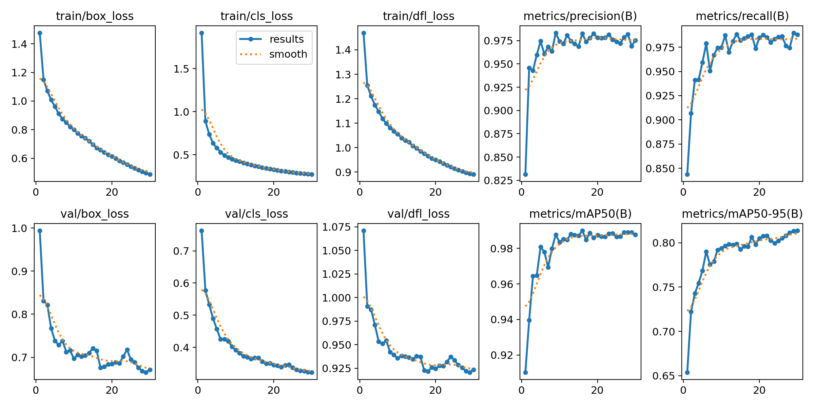
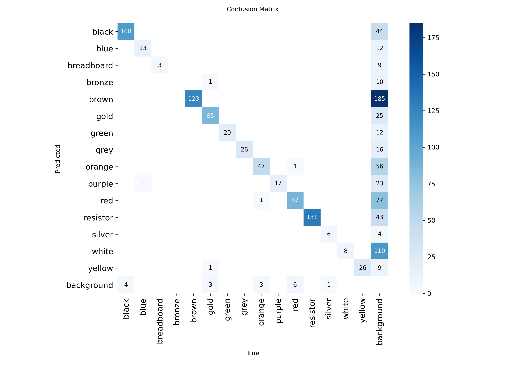
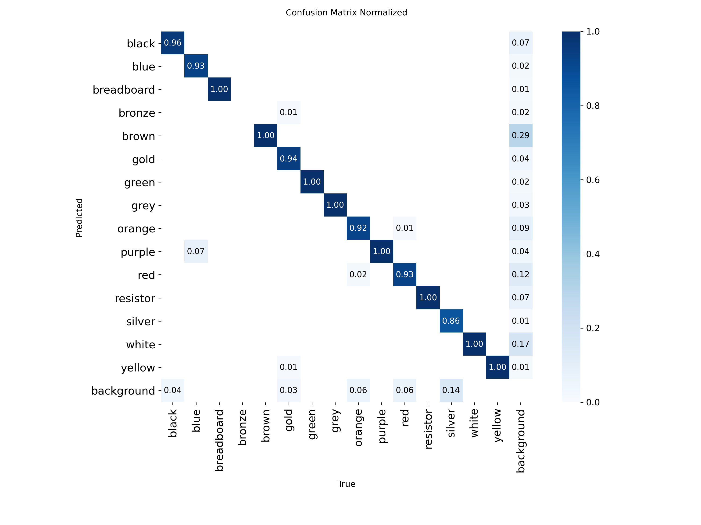

# Learning Log — Resistor Colour Band Detection

I trained YOLO11n to detect resistor bodies and individual colour bands. I applied two methods from the tutorials.

- **Tutorial Three — Data validation.** I checked that all 7,129 images had matching label files and that no original image filename appeared in more than one split.
- **Tutorial Seven — Training and evaluation.** I used the validation set to select the best checkpoint, then evaluated it on the held-out test set.

I kept the images in RGB to preserve the colour information needed to distinguish the bands. I skipped thresholding and morphology (Tutorial Four), filtering and edge detection (Tutorial Five), and LBP (Tutorial Six). I converted Roboflow's polygon annotations into axis-aligned bounding boxes for YOLO11n. The results show that RGB images were sufficient for this baseline. I would need a comparison run to tell whether preprocessing could improve it.

Validation mAP@50–95 rose from **65.39%** in epoch 1 to **81.36%** in epoch 30. On 131 test images, the selected checkpoint reached **96.42% mAP@50** and **78.83% mAP@50–95** across the evaluated classes.

*Figure 1. YOLO11n training and validation curves.*

The raw test matrix shows many predictions that did not match a labelled object, especially for brown and white. Breadboard had only three labelled test instances, and bronze had none. The normalised matrix makes class-level proportions easier to compare and leaves the underlying predictions unchanged.

*Figure 2. Test confusion matrix showing raw counts.*

*Figure 3. Test confusion matrix normalised by true-class column.*

My next step is to check the unmatched predictions and measure how often the model detects every band on a resistor in the correct order.
